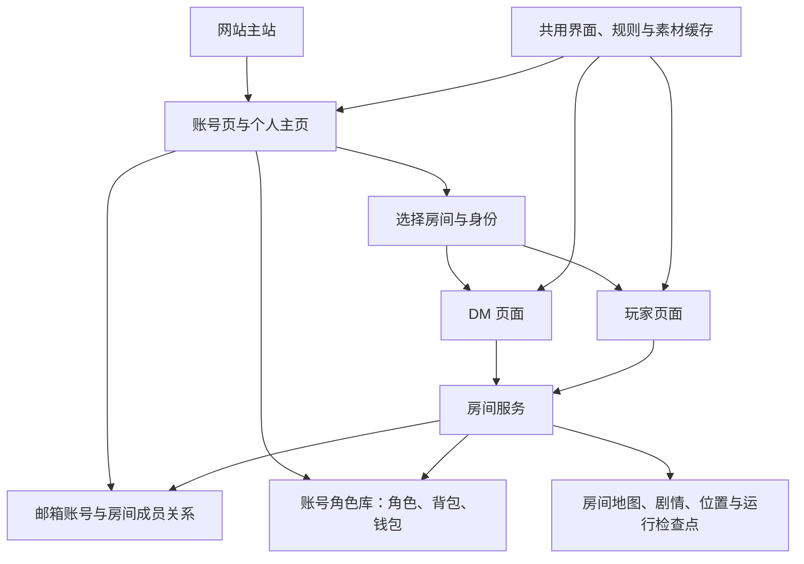

# 桑哆尔之歌 · 当前项目结构

核对日期：2026-10-25。日常入口只有根目录同名启动器的 macOS / Windows 两种包装。新检出的源码不含作者账号、房间或历史归档；先按 [部署与维护](../开发包/docs/部署与维护.md) 初始化账号服务，再启动和注册。

## 当前产品如何连接

账号直接拥有角色；DM 是某个房间的权限。房间引用参团角色，不能独立保存一份可分别成长的角色副本。同一角色在同一时间只允许一个房间修改其正式数据。

## 顶层目录

| 路径 | 用途 | 是否日常运行必需 |
| --- | --- | --- |
| `程序包/` | 网页服务与正式内容、数据 | 是 |
| `网站/` | Cloudflare Pages 主站与留言 Worker 源码 | 主站发布时需要 |
| `开发包/` | 测试、构建、维护和历史验收 | 否 |

以上为公开源码目录。运行后创建的账号、房间和备份属于本机私有数据；制作原稿和历史恢复材料由持有人另行保管，不作为玩家入口，也不随源码下载。不要重命名正在被存档和工具引用的内容目录。

## 正式数据在哪里

下列路径均相对于 `程序包/`。

| 路径 | 权威数据或职责 |
| --- | --- |
| `运行数据/认证/邮箱账号.sqlite3` | 邮箱账号、登录会话、房间、成员与邀请 |
| `运行数据/账号角色/角色.sqlite3` | 账号拥有的角色、各角色背包和钱包、参团关联、操作记录 |
| `运行数据/账号角色/资源/` | 账号角色的原始素材 |
| `运行数据/战役空间/<roomId>/` | 对应房间的独立内容、地图、剧情、协调数据库与运行检查点 |
| `运行数据/存档/` | 中央服务的工作区定位标记与进程锁，不再存游戏协调数据库 |
| `运行数据/账号房间模式.json` | 标记本安装只通过账号与房间读写游戏 |
| `运行数据/历史归档/<归档名>/` | 已有安装归档的旧通用包、战役包、玩家包、协调数据库和旧凭据；仅供历史找回 |

房间里的旧玩家包和历史资源记录用于迁移回执与恢复，不能仅因角色已绑定账号就删除。角色及附属单位归入全站角色库，无需再创建“玩家档案”；旧角色应由房主核对账号后确认归属。

原工作区归档保留同名战役的地图、附属棋子和模块身份差异，不自动覆盖当前房间。归档根目录的 `历史归档.json` 记录文件清单与哈希。启动器拒绝把该归档当作日常服务，旧无房间游戏 API 也不再读写它。新安装没有这类历史材料。

日常入口：启动器 → `/account#dashboard` → 选择有权限的房间 → DM／玩家页面。每个账号可以创建自己的房间。原 DM／玩家地址回到个人主页，不再出现另一套存档入口。需要找回差异时，只在隔离副本中检查并明确导入目标房间，不自动合并同名数据。

素材整理需保留路径、引用与内容独立性；不能用硬链接把历史原图与当前房间的可修改素材绑定在一起。去重和删除前先核对差异，并验证独有内容已经有完整恢复点。

`模块.json` 是模块身份；`记录/` 是版本化数据；`资源/` 是按哈希保存的原图。自动生成的 `棋子立绘/` 提供按名称浏览的副本。模块安装、卸载、移动角色应通过程序操作，不能只在 Finder 中搬动目录。

## 程序源码分工

| 路径（相对于主程序） | 职责 |
| --- | --- |
| `server/` | HTTP、权限、账号、房间、持久化与资源服务 |
| `server/domain/` | 日志、天气等业务数据处理 |
| `web/` | 邮箱登录、注册、个人主页及兼容入口 |
| `主控台/host/` | DM 界面、战役管理和主持操作 |
| `主控台/player/` | 玩家地图、状态和交互 |
| `主控台/shared/` | 两端共用的背包、日志、角色、骰子等功能 |
| `shared/` | 设计样式、会话、规则、通信和公共素材缓存 |
| `asset/界面/` | 公共主题图片、图标、界面音效 |
| `asset/地图/`、`asset/棋子库/` | 地图与立绘工具及兼容页面 |
| `主控台/vendor/` | 实际被使用的第三方代码 |
| `bin/` | 可选公网连接程序，不能当作废弃软件删掉 |
| `launch_entry.py` | 两平台共用的启动菜单与维护分发 |
| `launch_sundoll.py`、`start_server.py` | 服务启动与连接管理 |
| `manage_accounts.py` | 本机账号配置与维护 |
| `manage_installation*.py` | 全安装备份、校验、恢复 |

主程序内的两份启动包装用于独立发行，根目录包装用于日常操作；它们调用同一实现。旧格式读取代码用于隔离恢复和导入旧分享包，不构成日常入口。

## 缓存、备份与可清理内容

| 内容 | 处理规则 |
| --- | --- |
| `.DS_Store`、`__pycache__`、临时测试输出 | 不属于正式内容，可再生成 |
| `运行数据/战役空间/前端-*` | 房间服务生成的代码副本；只在确认没有服务使用后清理 |
| `.sundoll-cache/`、`音乐缓存/` | 包含派生文件，也可能保留上传原件或资源来源；不能整目录盲删 |
| 房间内的 `运行数据/存档/模块存储/` | 房间协调数据库、原始资源和回执，属于持久化数据 |
| 历史归档内的 `运行数据/整套备份/` | 旧单工作区恢复材料，不是当前产品的日常备份入口 |
| `私人备份/`、`运行数据/安装级备份/` | 全安装私人快照；按完整清单验证后恢复 |
| `运行数据/迁移暂存*/` | 应在迁移完成且核实无引用、备份一致后清理，不作为长期存档 |
| `开发包/发行候选/` | 可再生成的构建；重复展开目录可在 ZIP 完整匹配后删除 |

备份按当前可用恢复点和必要迁移恢复点轮换。删除重复历史副本前，必须核验剩余副本完整可恢复；每个安装自行保留必要的恢复说明，不使用作者本机的历史数量作为保留标准。

账号认证、账号角色、房间私有数据、完整备份和迁移暂存均排除在 Git 之外。主站发行使用公开文件清单，游戏发行使用 `开发包/build_distribution_v4.py`；不要用整个工作目录代替发行包。

## 暂停与历史范围

当前交付仅包含网页版。个人专用离线版不再提供，桌面客户端开发暂停，其原型和构建不在公开源码范围内。

当前维护工具见 [开发包说明](../开发包/README.md)；旧改造方案、验收截图和历史发布号只用于追溯。此次实际删除、校验依据和保留项见 本地精简记录（不随源码发布）。
